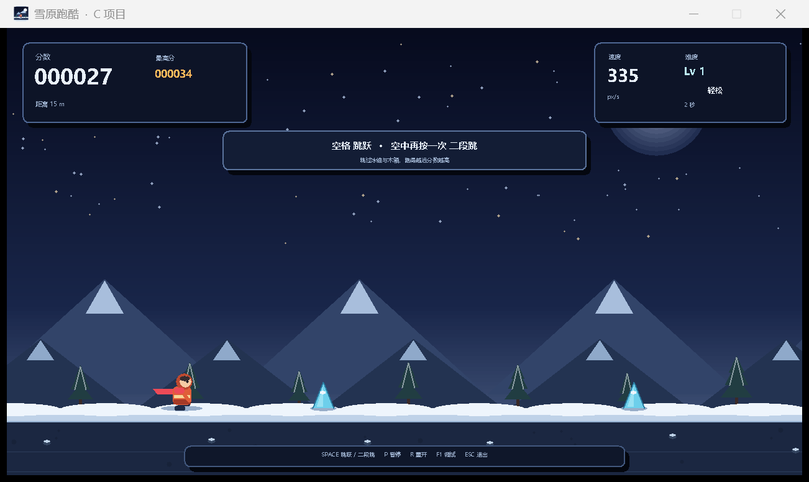

# 雪原跑酷 · Snow Parkour

Windows 10/11 上的 2D 横版无限跑酷 **可玩 MVP**。核心玩法用纯 C11 实现，EasyX 只存在于 C++17 适配层；CMake + MSVC 构建。

[三人协作：认领、提交、审核与合并](docs/team-workflow.md)



## 当前状态

| 项 | 状态 |
|---|---|
| 版本 | v0.1.0 |
| 目标平台 | Windows 10 / 11 x64 |
| 验证工具链 | Visual Studio 2026（MSVC 19.51）+ CMake 4.4.2 |
| 图形库 | EasyX 26.10.25（已随项目 vendored，无需全局安装） |
| 测试 | 765 项断言全绿；含 120 秒自动跑酷长局 |
| 音频 | 无（按 MVP 范围） |
| 交付形态 | 可编译源码；本机构建后生成 `build\Release\SnowParkour.exe` |

## 快速开始

环境要求：

- Windows 10/11 x64
- Visual Studio 2019/2022/2026，安装 **使用 C++ 的桌面开发** 工作负载
- CMake ≥ 3.21（脚本会自动选择对应的 Visual Studio 生成器）

```bat
:: 构建并运行 Release 版
scripts\run.bat

:: 只构建
scripts\build.bat Release

:: 构建 Debug 并运行全部无 EasyX 单元测试
scripts\test.bat Debug

:: 按模块过滤测试
scripts\test.bat --filter physics
scripts\test.bat --filter terrain
```

构建产物：

```text
build\Release\SnowParkour.exe
build\Release\sp_tests.exe
build\Release\highscore.dat      ← 首次产生最高分后生成
```

> EasyX 的 `.h` / `.lib` 已放在 `third_party/easyx`。项目不修改系统目录，也不要求安装 EasyX 安装包。

## 操作

| 按键 | 行为 |
|---|---|
| `Space` | 跳跃；空中再按一次为二段跳 |
| `P` | 暂停 / 继续 |
| `R` | GAME OVER 后重新开始 |
| 鼠标左键 | GAME OVER 后重新开始 |
| `F1` | 开关调试 HUD 与碰撞盒（编译期可关闭） |
| `Esc` | 退出 |

含跳跃缓冲（0.13 s）与土狼时间（0.10 s），落地前按下跳跃不会丢失输入。

## 玩法与实现

- **固定时间步**：逻辑固定 60 Hz（`1/60 s`），渲染循环用 QPC 累积器追帧，卡顿后丢弃积压避免追帧雪崩。
- **无限地形**：8 种障碍模板（单刺、双刺、三刺、木箱、双箱、高冰柱、宽冰墙、高柱+刺）按难度权重抽取；段间保留最小反应空隙。
- **难度递增**：速度从 330 px/s 平滑逼近约 520 px/s；模板间距 470 → 360 px；复杂度权重随时间上升；等级 1–10，每 20 秒一级。
- **一条命**：AABB 撞击即结束；冰锥使用内缩判定框，视觉擦边更宽容。
- **计分**：`距离(m) + 存活秒数 × 6`，距离按 45 px = 1 m 换算。
- **最高分**：写入 exe 同目录的 `highscore.dat`；带 magic、版本与校验和，文件损坏时回退为 0。
- **确定性**：显式 xorshift32 种子；同种子 + 同输入序列得到同一地形和结果。每局种子由 `base_seed + run_index * 0x9E3779B9` 派生。
- **内存**：`core/` 只用 C 标准库；Debug 构建启用 `_CrtSetDbgFlag` + `_CRTDBG_LEAK_CHECK_DF`。

## 架构边界

```text
main.c (C)
  └─ game_update / render_frame
       ├─ core/      纯 C11：state / physics / collision / terrain / difficulty / score / rng
       └─ platform/  C++17 + EasyX：窗口 / 渲染 / 输入 / QPC / 存储 / CRT
```

铁律在代码中落实：

- `src/core/**` 不包含任何 EasyX / Windows 头文件。
- `platform/platform.h` 用 `extern "C"` 暴露 C 接口。
- `GameState` 由 `main` 持有并显式传给 `game_update` / `platform_render`，core 内没有跨模块全局可变状态。

详细设计见 [docs/architecture.md](docs/architecture.md)。

## 测试

`sp_tests.exe` 不链接 EasyX，可在普通控制台运行：

```text
SnowParkour core tests | all
[ OK ] physics    (20 checks)
[ OK ] collision  (18 checks)
[ OK ] terrain    (644 checks)
[ OK ] difficulty (22 checks)
[ OK ] score      (16 checks)
[ OK ] game       (45 checks)
RESULT: 765 checks, 0 failures
```

覆盖重点：

- 跳跃、二段跳、土狼时间、跳跃缓冲、落地重置、下落限速；
- AABB 边界接触、冰锥内缩、空地形、非法指针；
- 地形生成、模板内坐标、段间最小距离、障碍随段滚动、回收、同种子复现、120 秒滚动；
- 难度单调性、上限/下限钳制；
- 计分公式、最高分保留、新纪录标记；
- 暂停冻结、F1 开关、GAME OVER、R 重开、ESC、同种子确定性；
- **120 秒自动跑酷**：测试内置一个按跳跃曲线计算起跳窗口的自动玩家，验证地形长期可通关。

## 调试与内存检查

- 运行时按 `F1`：显示 FPS、速度、间距、难度等级、种子、跳跃状态、地形段数、玩家/障碍 AABB。
- 编译期关闭：CMake 配置时传入 `-DSP_ENABLE_DEBUG_HUD=OFF`（生成器按本机 Visual Studio 版本选择），`F1` 与调试绘制会被编译掉。
- Debug 构建退出时自动执行 CRT 泄漏检查，并写入工作目录的 `leak_report.txt`：
  - 文件为空 = 无泄漏；
  - 本地运行 Debug 需要非可再分发的 VS Debug CRT，`scripts\_debug_env.bat` 会临时补 PATH。
- Release 构建不引入 CRT 泄漏检查开销。

## 目录

```text
C项目/
├─ CMakeLists.txt
├─ README.md
├─ src/
│  ├─ main.c
│  ├─ core/                 # 纯 C，可脱机测试
│  └─ platform/             # C++ / EasyX / Win32
├─ tests/                   # 无 EasyX 单元测试 + 120 秒自动玩家
├─ scripts/                 # build / test / run / debug-env
├─ assets/                  # 程序化图标、资源说明
├─ third_party/easyx/       # vendored EasyX 26.10.25
└─ docs/                    # 需求、架构、素材来源、截图
```

## 文档

- [需求规格](docs/requirements.md)
- [架构与决策](docs/architecture.md)
- [素材来源与许可](docs/asset-credits.md)
- [GAME OVER 截图](docs/screenshot-gameover.png) · [暂停截图](docs/screenshot-pause.png) · [F1 调试截图](docs/screenshot-debug.png)

## 已知限制（MVP 范围）

- 地面是连续平地，只有障碍变化；尚未加入深坑、高低平台、滑铲。
- 美术由 EasyX 几何图元程序化绘制，无精灵图/粒子/音频。
- 仅 Windows + EasyX；CMake 保留了 MinGW 分支和 EasyX MinGW 库，但本次验收只验证 MSVC。
- 鼠标只用于 GAME OVER 点击重开，无手柄。

## 第三方

EasyX Graphics Library 26.10.25，版权归 EasyX 作者所有，使用请遵循 [EasyX 版权声明](https://easyx.cn/copyright)。素材与哈希详见 [docs/asset-credits.md](docs/asset-credits.md)。
